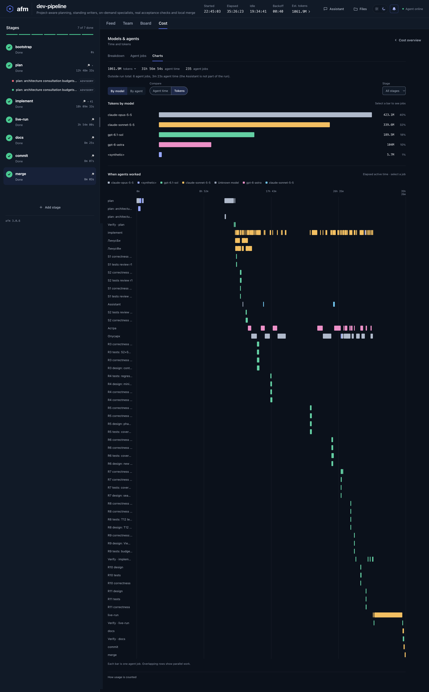
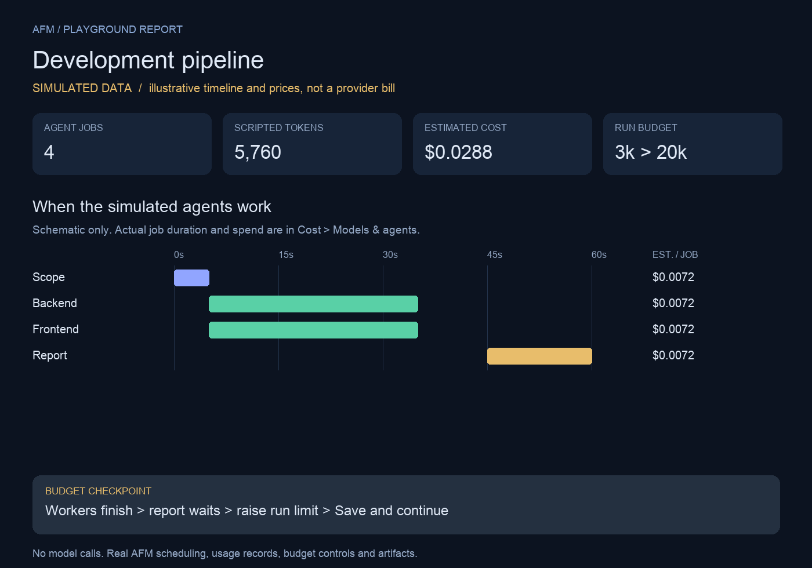
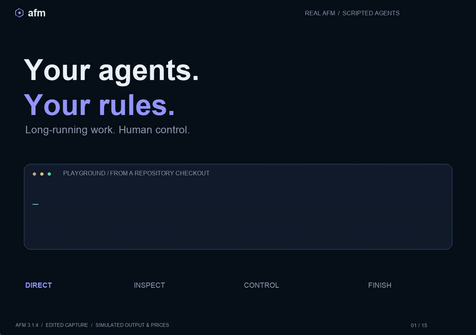
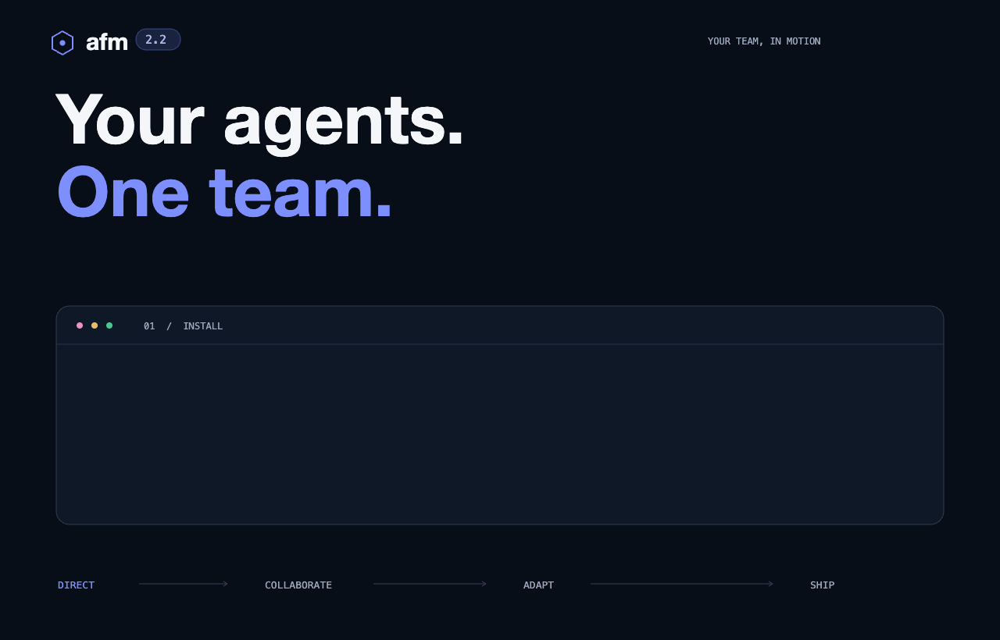
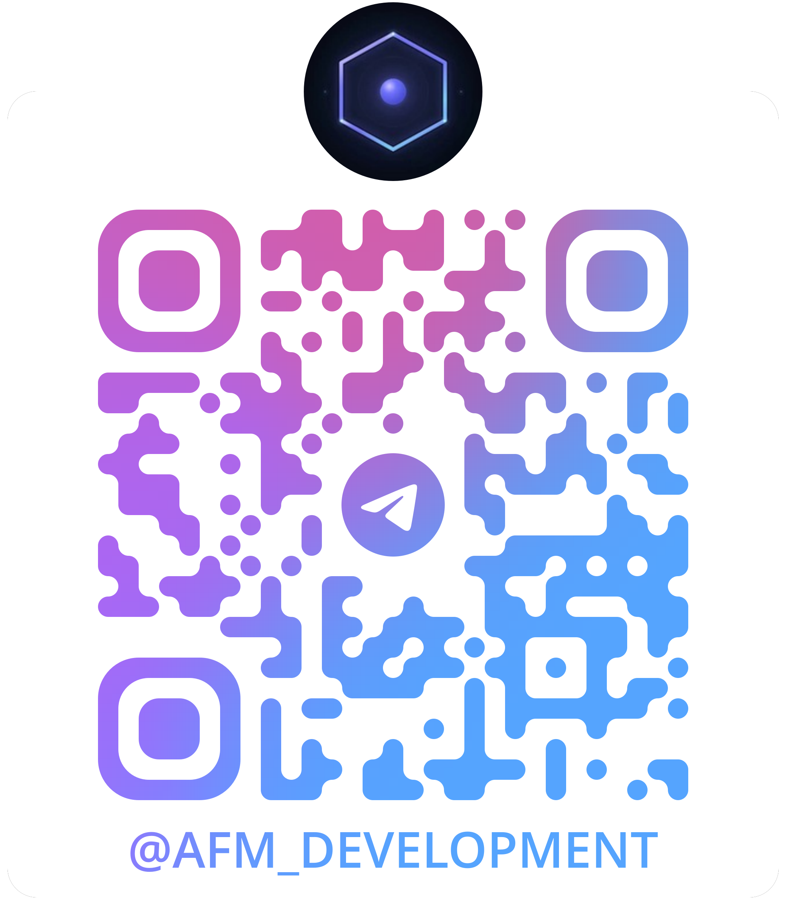

# afm

## Your agents. One team. You're in control.

[Build a pipeline](#build-your-own-flow) around the way you work, or start with
[a ready-made one](#run-a-pipeline-on-your-project).
Choose the stages, agents, checks and approval points — from a single task to
hours of coordinated work. Use AFM to build a feature, review code, plan a
refactor, or run a workflow of your own.

Mix Claude, Codex and other compatible clients across roles. Review decisions,
follow conversations, inspect results and control spending in a live dashboard.
Stop and resume: AFM preserves the run's recorded progress.

<br>

[](https://github.com/akopichin/afm/actions/workflows/ci.yml)
[](https://github.com/akopichin/afm/releases)
[](https://goreportcard.com/report/github.com/akopichin/afm)
[](LICENSE)
[](https://akopichin.github.io/afm/)
[](https://t.me/afm_development)

[Documentation ↓](#documentation)

## What a long run looks like

A real `dev-pipeline` run: **7 stages, 235 agent jobs and over 35 hours elapsed**,
from planning through implementation, live acceptance checks, docs, commit and
merge. The timeline shows parallel work, reviews and specialist interventions.
This is an example of orchestration at scale, not a typical runtime or cost claim.

<p align="center">

</p>

[Open the full-size screenshot](docs/assets/long-flow.png).

## Try it without model accounts

With AFM and Python 3 installed, run this from a checkout of this repository:

```bash
python3 examples/playground/run.py
```

It opens a separate playground with **simulated agents and real AFM state**.
Answer the Scope question, watch parallel work, explore the Cost charts, then
raise the deliberately small budget to let the final report start. No provider
login is needed. The final agent posts a visual report directly into the feed;
agent output, tokens, timelines in that image and prices are illustrative.



Try `--scenario review` for five parallel reviewers or `--scenario refactor`
for two architects. See the [playground walkthrough](docs/playground.md) for
installation, restart, cost exploration and budget controls.

## Run a pipeline on your project

Install AFM ([other platforms and setup](docs/getting-started.md)):

```bash
brew install --cask akopichin/afm/afm
```

[**afm-pipelines**](https://github.com/akopichin/afm-pipelines) is the reusable
workflow catalog for **AFM 3.1.4+**. Packages include the flow, agent roles,
skills and supporting scripts. AFM fetches and snapshots the package; there is
no separate catalog installation and it does not rewrite your configuration.

| Pipeline | Use it for | Result |
|---|---|---|
| [dev-pipeline](https://github.com/akopichin/afm-pipelines/tree/main/pipelines/dev-pipeline) | Delivering a feature or fixing a bug with coordinated writers, independent reviews and acceptance checks | A checked change, documentation, commit and optional approved local merge |
| [review](https://github.com/akopichin/afm-pipelines/tree/main/pipelines/review) | Reviewing a branch, uncommitted changes or selected files from five perspectives | A deduplicated, ranked report with evidence and coverage gaps; no automatic fixes |
| [refactor](https://github.com/akopichin/afm-pipelines/tree/main/pipelines/refactor) | Understanding an architecture and agreeing on a refactoring direction with two architects | An interactive workshop and approved refactoring plans; implementation is a separate step |

From your project, after configuring the required tools and provider access:

```bash
afm run --pipeline github.com/akopichin/afm-pipelines//pipelines/dev-pipeline@v2.0.1 --worktree my-change
```

In a pipeline source, `//` separates the Git repository from the package folder:
`afm-pipelines` is the repository, `pipelines/dev-pipeline` is the folder inside it.
The format is `<repo>//<subdir>@<ref>`. Keep both slashes before `pipelines`:
using a single slash makes AFM fetch the package folder as a repository and fails
with `repository not found`.

That is the one-command **run**, not a one-command provider setup. Before the
first run, check the package's effective roles and missing requirements without
starting agents:

```bash
afm pipelines inspect github.com/akopichin/afm-pipelines//pipelines/dev-pipeline@v2.0.1
```

The catalog currently recommends Opus 5.5 for planning/architecture, Sonnet 5.5
for routine development, GPT-6.1 Sol for independent checks, and GPT-6 Astra for
escalation in `dev-pipeline`. `review` pairs Sonnet with five Sol reviewers;
`refactor` pairs Opus and Sol architects. **Use accounts with access to those
models, or override the complete role recipes** with `--pipeline-options`.
The identities are recommendations; the roles and workflow checks still matter.
Inspect reports requested settings, not proof of provider access.

Docker/autoShim, collaboration, browser support and runtime tools depend on the
package. Follow the [catalog setup guide](https://github.com/akopichin/afm-pipelines/blob/main/docs/installer.md)
and [model overrides](https://github.com/akopichin/afm-pipelines/blob/main/docs/model-bindings.md).
The `afm-pipelines` agent skill can help choose and configure a package; use a
current version that understands catalog v2.

Repeat the same command to resume. Use a new worktree name for a new development
task. Review uncommitted changes in the current checkout, without `--worktree`.
The review package was added after `v2.0.1`; use the catalog revision that includes it:

<!-- TODO: replace the review commit with the first catalog release tag that includes this package. -->

```bash
afm run --pipeline github.com/akopichin/afm-pipelines//pipelines/review@c591e4256c1c04136615f3291429201e5e46e0ce
```

## See where time and money go

In **Cost**, compare stages, then open **Models & agents**:

- **Breakdown:** time, tokens and estimated cost by model or individual agent.
- **Agent jobs:** each invocation's stage, start, duration and estimated cost.
- **Charts:** compare cost, time or tokens; select a bar to inspect its jobs.
  The **When agents worked** timeline reveals parallel work and long-running jobs.
- **Budgets:** set limits for the run, stages or agents. Choose warnings only,
  finish active work, or stop; raise a limit with **Save and continue**.

Dollar figures require `accounting.show_money: true` and known prices. They are
**list-price estimates**, including for subscription clients. A dollar budget
requires explicit complete rate cards. See [accounting](docs/accounting.md),
[budgets](docs/budgets.md) and the [hands-on demo](docs/playground.md).

## Watch the controls in action

A quick preview of the playground: inspect agent costs, raise a budget and
open the visual report. Try the demo yourself to explore the full workflow.



[Try the same playground](docs/playground.md)

<details>
<summary>Earlier demo: conversations, helper review and recovery after usage limits</summary>



</details>

## Why afm

- **Checks before completion.** Declare stage dependencies and artifacts, then
  gate results with [test commands and independent AI review](docs/verify.md).
  Agents can also exercise the app in a [managed browser](docs/browser.md).
- **Coordination across agents.** Specialists exchange findings, track work on
  a shared board and wait for colleagues' replies. See
  [helpers and collaboration](docs/collaboration.md).
- **Durable, inspectable progress.** Completed stages, approvals, conversations
  and pending waits survive restarts. Logs, events and artifacts stay on disk.
  See [resume on restart](docs/stage-lifecycle.md#resume-on-restart).
- **Workflows that carry forward.** [Repeat a successful flow](docs/flow-reference.md#repeat-run-successful-flows-again),
  schedule prompts with [`/loop`](docs/loops.md), or enable
  [memory](docs/agent-memory.md) to carry project lessons into later runs.

## Build your own flow

[Install AFM first](docs/getting-started.md), then run from your project:

```bash
afm init                                # scaffold a flow into .afm/flows/ interactively
afm run                                 # run the flow from .afm/flows (or: afm run path/to/flow.yaml)
```

A live dashboard comes up at `http://localhost:9876` (its URL is printed to the log).

After the planning phase each stage waits at `awaiting_approval` — review and approve
the plan in the dashboard, and afm implements it. Follow along with `afm check` or the
dashboard. (The CLI `afm approve`/`revise`/`retry` commands are for headless use — a
live `afm run` holds an exclusive lock, so approve through the dashboard while it's
running.)

## A minimal flow.yaml

```yaml
name: my-feature
description: "Add JWT auth"

stages:
  - id: backend
    name: "Backend API"
    description: "Implement the login/logout endpoints and JWT middleware."
    agents: [planning, implementation, review]
    verify: "make test"
    artifacts:
      - name: api-contract
        path: docs/api-contract.yaml
        description: "OpenAPI specification"

  - id: frontend
    name: "Frontend"
    description: "Build the login UI against the API contract."
    agents: [planning, implementation]
    depends_on: [backend]
    inputs:
      - backend.api-contract
    verify: "make test"
```

Replace `make test` with your project's test command. The frontend starts after
the backend and its verification pass, and receives the declared API contract.
A failed check sends the stage back for correction within its configured budget.

For collaborating agents and independent AI review, see the
[team review example](examples/agent-team-review/). More flows live in
[`examples/`](examples/), and every field is described in the
[flow.yaml reference](https://akopichin.github.io/afm/flow-reference/).

To give a flow its own branch and working directory, set `worktrees: true` at the
top of `flow.yaml`. afm runs its stages in `<project-root>/.worktrees/<flow-name>`
and keeps run state in the original `.afm/`. Use `afm run --worktree <name>` to
choose a different branch and worktree for a run. See
[per-flow git worktrees](https://akopichin.github.io/afm/flow-reference/#per-flow-git-worktrees)
for configuration and reset options.

## Lifecycle hooks

Connect flow and stage events to notifications, metrics, or external status
updates with [lifecycle hooks](docs/lifecycle-hooks.md). Hooks receive JSON on
stdin and `AFM_*` environment variables, with secrets supplied by reference.
They observe the flow; a hook failure does not change its result. See the guide
for configuration and examples.

## Documentation

Full documentation lives at **[akopichin.github.io/afm](https://akopichin.github.io/afm/)**:

| Topic | |
|-------|--|
| Install, first flow, approving plans | [Getting started](https://akopichin.github.io/afm/getting-started/) |
| Every `flow.yaml` field | [flow.yaml reference](https://akopichin.github.io/afm/flow-reference/) |
| `config.yaml`, `--dir`, `--debug` | [Configuration](https://akopichin.github.io/afm/config-reference/) |
| Statuses and resume | [Stage lifecycle](https://akopichin.github.io/afm/stage-lifecycle/) |
| `agents: [auto]` | [Autonomous track](https://akopichin.github.io/afm/autonomous-track/) |
| Test commands and independent AI review | [Verification](https://akopichin.github.io/afm/verify/) |
| Dialog with the agent | [Interactive stages](https://akopichin.github.io/afm/interactive-stages/) |
| Event notifications, secrets in hooks | [Lifecycle hooks](https://akopichin.github.io/afm/lifecycle-hooks/) |
| Carrying lessons across runs | [Agent memory](https://akopichin.github.io/afm/agent-memory/) |
| Token/cost tracking, `pricing:` overrides | [Cost accounting](https://akopichin.github.io/afm/accounting/) |
| The web dashboard | [Dashboard](https://akopichin.github.io/afm/dashboard/) |
| AFM from a private Telegram chat | [Telegram bot](https://akopichin.github.io/afm/telegram-bot/) |
| Agent teams: run agents, conversations, board, helpers | [Helpers and collaboration](https://akopichin.github.io/afm/collaboration/) |
| Recurring prompts during a run | [Repeating prompts](https://akopichin.github.io/afm/loops/) |
| Exercising an app in Chrome | [Managed browser](https://akopichin.github.io/afm/browser/) |
| Running in Docker, non-Claude agents | [Docker mode](https://akopichin.github.io/afm/docker/) |
| Driving afm from Go | [Go SDK](https://akopichin.github.io/afm/sdk/) |
| Event log, directory layout, prompts | [Internals](https://akopichin.github.io/afm/internals/directory-layout/) |

## Community

Follow AFM on Telegram: [@afm_development](https://t.me/afm_development).

<a href="https://t.me/afm_development">
  
</a>

## Development

```bash
make build        # build (bin/afm)
make test         # tests (with -race)
make lint         # linter
make install      # go install
make docker-build # build the Docker image
```

Versioned release: `make release-patch` / `release-minor` / `release-major` bumps the
SemVer tag and pushes it; the actual build (Docker image + binaries + GitHub Release +
Homebrew cask) happens in GitHub Actions once the tag is pushed. Add `-alpha` or
`-beta` to any release target for numbered prereleases, for example
`make release-major-alpha` creates `v2.0.0-alpha.1` from stable `v1.x.y` and
increments the alpha counter on subsequent calls. Install the separate Homebrew
casks with `brew install --cask akopichin/afm/afm-alpha` or `afm-beta`; they provide
commands `afm-alpha` and `afm-beta` alongside stable `afm`. Pushes to `main` run
CI checks; releases require an explicit version tag, created with `make release-*`.
See [Releases and prereleases](docs/releases.md) for details, the
[CHANGELOG](CHANGELOG.md) for release history, and
[CONTRIBUTING](CONTRIBUTING.md) to get started.

For fixes and minor features on the old release line, use the `v1.x` maintenance
branch. See [the 1.x contribution workflow](CONTRIBUTING.md#maintaining-the-1x-release-line)
for feature worktrees, dev-pipeline, merging and separate patch/minor releases.

## License

[MIT](LICENSE).
