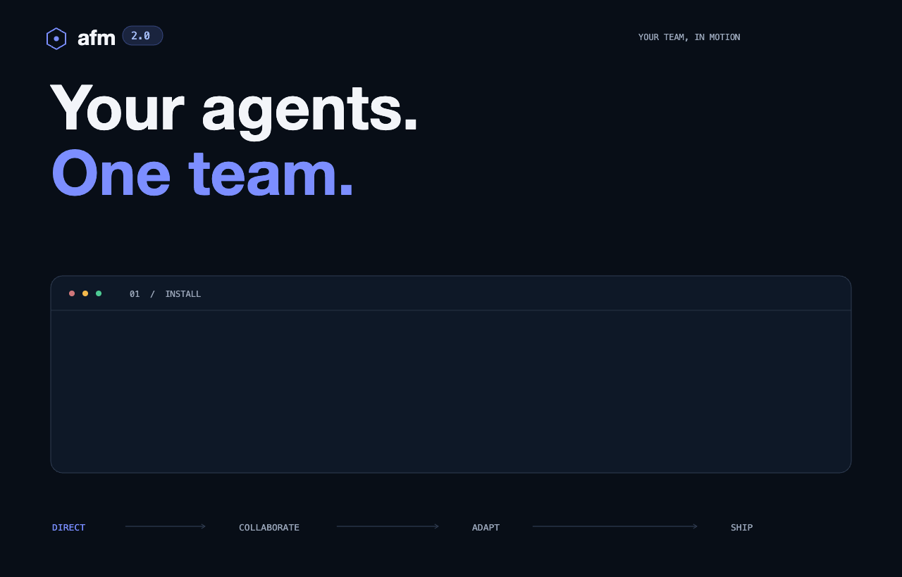
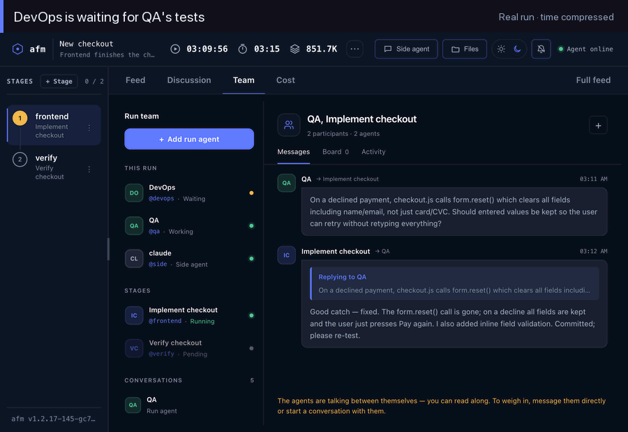

# afm

**A control plane for AI agent teams.** Put several agents on one job — stage
agents that own a step of the flow, run agents that join for the whole run — let
them talk to each other directly, and keep a human in the loop. Every message,
wait and stage transition is written to an event log, so a run survives a restart
and you can always see who did what.

Use Claude, Codex, GLM, DeepSeek, Cursor, or other compatible agents — together in the
same workflow.

[](https://github.com/akopichin/afm/actions/workflows/ci.yml)
[](https://github.com/akopichin/afm/releases)
[](https://goreportcard.com/report/github.com/akopichin/afm)
[](LICENSE)
[](https://akopichin.github.io/afm/)

<p align="center">
  
</p>

## Why afm, when Claude Code already exists

- **Agents that coordinate directly.** QA asks Frontend a question, Frontend fixes
  the bug QA found, DevOps picks up QA's tests the moment they are ready — through
  conversations, a shared board and durable waits, not by you copying text between
  sessions. You follow and steer it all in the **Team** tab.
- **Tasks measured in hours, not minutes.** Every run is written to an append-only
  event log; if it's interrupted, `afm run` resumes from the same point — completed
  stages are skipped, interrupted ones retried, and agents' conversations and waits
  come back with it.

  <p align="center">
    
  </p>

- **Several models in one flow.** Claude plans, a cheaper model (GLM/DeepSeek) does
  the routine work, another reviews — each stage can use a different agent.
- **A human in the loop at the plan level.** Review and comment on the plan
  line-by-line *before* any code is written, like a merge request.
- **An explicit dependency graph and artifacts** between stages, instead of implicit
  shared context.
- **Everything on disk** — logs, events, and (with `--debug`) the exact prompt each
  agent received. You can see what happened after the fact.

## Quick start

```bash
brew install --cask akopichin/afm/afm   # or see the install guide for Linux/Docker/source
afm init                                # scaffold a flow into .afm/flows/ interactively
afm run                                 # run the flow from .afm/flows (or: afm run path/to/flow.yaml)
```

A live dashboard comes up at `http://localhost:9876` (its URL is printed to the log).

After the planning phase each stage waits at `awaiting_approval` — review and approve
the plan in the dashboard, and afm implements it. Follow along with `afm check` or the
dashboard. (The CLI `afm approve`/`revise`/`retry` commands are for headless use — a
live `afm run` holds an exclusive lock, so approve through the dashboard while it's
running.)

## A minimal flow.yaml

```yaml
name: my-feature
description: "Add JWT auth"

stages:
  - id: backend
    name: "Backend API"
    description: "Implement the login/logout endpoints and JWT middleware."
    agents: [planning, implementation, review]
    artifacts:
      - name: api-contract
        path: docs/api-contract.yaml
        description: "OpenAPI specification"

  - id: frontend
    name: "Frontend"
    description: "Build the login UI against the API contract."
    agents: [planning, implementation]
    depends_on: [backend]
    inputs:
      - backend.api-contract
```

See more in [`examples/`](examples/), and every field in the
[flow.yaml reference](https://akopichin.github.io/afm/flow-reference/).

To give a flow its own branch and working directory, set `worktrees: true` at the
top of `flow.yaml`. afm runs its stages in `<project-root>/.worktrees/<flow-name>`
and keeps run state in the original `.afm/`. Use `afm run --worktree <name>` to
choose a different branch and worktree for a run. See
[per-flow git worktrees](https://akopichin.github.io/afm/flow-reference/#per-flow-git-worktrees)
for configuration and reset options.

## Lifecycle hooks

Observe flow/stage events — notifications, metrics, external status — with
**lifecycle hooks**. They only observe: a hook error never touches the FSM or the
flow result. Declare them in `config.yaml`, the flow root, or a single stage:

```yaml
hooks:
  - id: telegram
    events: all                       # or a list, e.g. [flow_finished, stage_failed]
    command: "bash ~/.afm/t-notify.sh"
    env:                              # secrets injected by reference, never in argv/logs
      TELEGRAM_BOT_TOKEN: "file:~/.afm/secrets/telegram-bot-token"
      TELEGRAM_CHAT_ID:   "env:TELEGRAM_CHAT_ID"

stages:
  - id: build
    script: "make build"
```

The hook command gets the event as JSON on stdin plus `AFM_*` env vars
(`AFM_HOOK_EVENT`, `AFM_STAGE_ID`, `AFM_STAGE_FROM`/`AFM_STAGE_TO`, …), so a
one-liner works:

```bash
#!/usr/bin/env bash
msg="afm: ${AFM_HOOK_EVENT} — ${AFM_FLOW_NAME} / ${AFM_STAGE_ID:-flow}"
curl -fsS --data-urlencode "chat_id=${TELEGRAM_CHAT_ID}" \
     --data-urlencode "text=${msg}" \
     "https://api.telegram.org/bot${TELEGRAM_BOT_TOKEN}/sendMessage" >/dev/null
```

Full event catalog, secret/`env:` reference, redaction and Docker transport in
[Lifecycle hooks](https://akopichin.github.io/afm/lifecycle-hooks/).

## Documentation

Full documentation lives at **[akopichin.github.io/afm](https://akopichin.github.io/afm/)**:

| Topic | |
|-------|--|
| Install, first flow, approving plans | [Getting started](https://akopichin.github.io/afm/getting-started/) |
| Every `flow.yaml` field | [flow.yaml reference](https://akopichin.github.io/afm/flow-reference/) |
| `config.yaml`, `--dir`, `--debug` | [Configuration](https://akopichin.github.io/afm/config-reference/) |
| Statuses and resume | [Stage lifecycle](https://akopichin.github.io/afm/stage-lifecycle/) |
| `agents: [auto]` | [Autonomous track](https://akopichin.github.io/afm/autonomous-track/) |
| File-based dialog | [Interactive stages](https://akopichin.github.io/afm/interactive-stages/) |
| Event notifications, secrets in hooks | [Lifecycle hooks](https://akopichin.github.io/afm/lifecycle-hooks/) |
| Carrying lessons across runs | [Agent memory](https://akopichin.github.io/afm/agent-memory/) |
| Token/cost tracking, `pricing:` overrides | [Cost accounting](https://akopichin.github.io/afm/accounting/) |
| The web dashboard | [Dashboard](https://akopichin.github.io/afm/dashboard/) |
| AFM from a private Telegram chat | [Telegram bot](https://akopichin.github.io/afm/telegram-bot/) |
| Agent teams: run agents, conversations, board, helpers | [Helpers and collaboration](https://akopichin.github.io/afm/collaboration/) |
| Running in Docker, non-Claude agents | [Docker mode](https://akopichin.github.io/afm/docker/) |
| Driving afm from Go | [Go SDK](https://akopichin.github.io/afm/sdk/) |
| Event log, directory layout, prompts | [Internals](https://akopichin.github.io/afm/internals/directory-layout/) |

## Development

```bash
make build        # build (bin/afm)
make test         # tests (with -race)
make lint         # linter
make install      # go install
make docker-build # build the Docker image
```

Versioned release: `make release-patch` / `release-minor` / `release-major` bumps the
SemVer tag and pushes it; the actual build (Docker image + binaries + GitHub Release +
Homebrew cask) happens in GitHub Actions once the tag is pushed. Add `-alpha` or
`-beta` to any release target for numbered prereleases, for example
`make release-major-alpha` creates `v2.0.0-alpha.1` from stable `v1.x.y` and
increments the alpha counter on subsequent calls. Install the separate Homebrew
casks with `brew install --cask akopichin/afm/afm-alpha` or `afm-beta`; they provide
commands `afm-alpha` and `afm-beta` alongside stable `afm`. Pushes to `main` run
CI checks; releases require an explicit version tag, created with `make release-*`.
See [Releases and prereleases](docs/releases.md) for details, the
[CHANGELOG](CHANGELOG.md) for release history, and
[CONTRIBUTING](CONTRIBUTING.md) to get started.

## License

[MIT](LICENSE).
