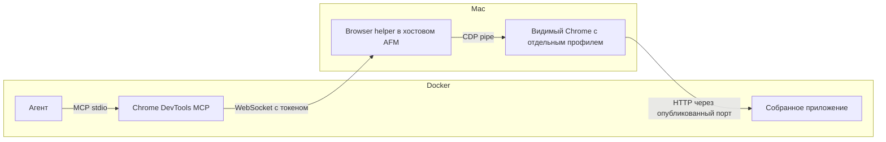

# Chrome DevTools из контейнера: проверка подхода и план внедрения

Дата: 2026-10-01. Репозиторий на момент исследования: `1807cd9`.
Статус: эксперимент выполнен, production-код AFM не изменён.

## Результат и выбранный подход

Агент и Chrome DevTools MCP остаются в контейнере. Хостовый AFM управляет
небольшим browser helper, который по первому браузерному вызову запускает
видимый Chrome на Mac с отдельным профилем. Helper соединяет защищённый
WebSocket с `--remote-debugging-pipe` Chrome.

Таким образом, просьба «сделай живой прогон» и отдельная стадия используют
одни и те же MCP-инструменты. Пользователь не запускает Chrome вручную,
не включает Remote Login и не настраивает CDP-порт.



Первая поставка должна закрыть текущий сценарий: **macOS + Docker Desktop +
Chrome + Claude/claude recipes**. Codex подключается отдельным адаптером в
том же плане. Автоматическая поддержка Linux Docker/Windows требует своих
проверок; macOS-результат нельзя объявлять проверкой этих платформ.

## Что фактически проверено

Эксперимент запускался в `/private/tmp/afm-chrome-cdp-a20w6myf`.
Контейнер `afm-chrome-cdp-a20w6myf` использовал существующий образ
`akopichin/afm:v1.2.4`, без маунта проекта, пользовательского home,
OAuth/API-токенов или Docker socket. В него монтировалась только директория
эксперимента. Приложение — небольшой HTTP-сервер с настоящими DOM-событиями
и `fetch`; его исходники находятся в evidence.

| Компонент | Проверенная версия / режим |
| --- | --- |
| Docker | 28.5.1 |
| Chrome на Mac | 154.0.8037.92, обычное видимое окно |
| Node в контейнере | 22.23.3 |
| Chrome DevTools MCP | 1.10.1, закреплённая версия |
| Claude Code в контейнере | 2.1.212 |
| Host helper | Временный Node-прототип; production-план использует Go |
| Приложение | Python HTTP-сервер внутри Linux-контейнера |
| Публикация приложения | `-p 127.0.0.1::3000`, назначенный Docker порт 55115 |

Пройдены следующие проверки:

1. Helper, слушающий **127.0.0.1 на Mac**, доступен из контейнера через
   `host.docker.internal` в этом Docker Desktop окружении.
2. Запрос без токена получает 401; он не запускает Chrome.
3. WebSocket handshake без токена также получает 401.
4. `initialize` и `tools/list` настоящего MCP-сервера не запускают Chrome.
5. Первый `new_page` запускает Chrome на Mac и открывает приложение из
   контейнера. В pipe-варианте вызов занял около **1,30 секунды**.
6. Повторный запрос использует тот же принадлежащий эксперименту Chrome.
7. `take_snapshot`, `fill`, `click`, `wait_for` прошли реальный сценарий.
8. `evaluate_script` подтвердил результат в DOM, ответ приложения и
   macOS user agent браузера.
9. `list_console_messages` прочитал `AFM_CDP_CLICK_OK`.
10. `list_network_requests` увидел реальный `POST /api/probe` с HTTP 200.
11. `take_screenshot` сохранил PNG в файловую систему контейнера.
12. Claude Code через `claude mcp list` подтвердил состояние `Connected`.
13. Для pipe-варианта Chrome запущен с `--remote-debugging-pipe`, без
    `--remote-debugging-port`.
14. При завершении эксперимента остановлены его helper, Chrome и контейнер;
    временный токен и приватный MCP config удалены.

Отдельно проверен TCP-вариант. Прямой запрос из контейнера к
`http://host.docker.internal:<chrome-port>/json/version` вернул HTTP 500:
`Host header is specified and is not an IP address or localhost.`
HTTP/WS proxy с переписанным Host работал, но для встроенного решения выбран
pipe: Chrome не публикует отдельный неаутентифицированный CDP-порт.

SSH-порт Mac доступен, однако вход по имеющимся ключам завершился
`Permission denied`. Настройки SSH не менялись. Поэтому зависимость
встроенного решения от SSH здесь не нужна.

**Граница проверки:** MCP-протокол и браузерные инструменты проверены
детерминированным клиентом, без обращения к LLM. Claude CLI проверен на
регистрацию и соединение. Полный `afm run` с автоматически внедрённым MCP,
Codex MCP-вызов, многопользовательские сценарии и другие ОС пока не проверены.

Материалы:

- [Итоговый pipe-отчёт](./chrome-devtool-evidence/report.json).
- [TCP-отчёт и ошибка Host](./chrome-devtool-evidence/tcp-report.json).
- [Скриншот](./chrome-devtool-evidence/live-probe.png).
- [MCP-вызовы и ответы](./chrome-devtool-evidence/mcp-transcript.json).
- [Ответ приложения](./chrome-devtool-evidence/app-request.json).
- [Claude MCP health](./chrome-devtool-evidence/claude-mcp-health.log).
- [Pipe helper](./chrome-devtool-evidence/host-helper-pipe.mjs),
  [TCP helper](./chrome-devtool-evidence/host-helper.mjs),
  [MCP-клиент](./chrome-devtool-evidence/mcp-client.py),
  [приложение](./chrome-devtool-evidence/app.py).

Это прототипы для проверки транспорта, а не код для переноса в production.
У них один browser session и ограниченная обработка ошибок.

## Что уже есть в AFM и где врезаться

- `cmd/afm/run.go`: preflight, Docker-ветка, затем `executeFlow` и ownership
  ресурсов через defer.
- `cmd/afm/run_environment.go:reexecFlow`: сборка Docker-параметров.
- `pkg/docker/launcher.go:defaultExecFunc`: **хостовый AFM остаётся живым**,
  запускает Docker дочерним процессом, пересылает SIGINT/SIGTERM и ждёт выход.
  Старые комментарии про безвозвратный `syscall.Exec` уже не описывают код.
  Это позволяет держать helper прямо в хостовом AFM и закрывать его через defer.
- `pkg/docker/launcher.go:ReExec`: сейчас публикует только dashboard port,
  переносит `~/.claude/`, но намеренно не монтирует `~/.claude.json`.
- `pkg/orchestrator/runner_factory.go`: обычные, interactive, fallback и
  verify runner; MCP-подготовка должна покрыть все обычные пути запуска.
- `pkg/executor/executor.go`: создание subprocess, аргументы и фильтр env;
  `RunJSONQuery` и вспомогательные процессы тоже требуют явной политики.
- `scripts/codex-as-claude.sh`: самостоятельно собирает `codex_args`;
  Claude-аргумент `--mcp-config` не подключит MCP к Codex.
- `assets/claude/skills/`: собственный `live-run` пока не поставляется AFM.
  Нельзя рассчитывать на личный `~/.claude/skills/live-run` пользователя.

Browser helper не должен быть lifecycle hook: observer-хуки best-effort,
выполняются внутри текущего процесса/контейнера и не обеспечивают обязательную
готовность инструмента.

## Контракт пользователя

Предлагаемая конфигурация:

```yaml
browser:
  enabled: true       # nil/не задано: auto на поддержанном хосте с Chrome
  headless: false     # по умолчанию видимый Chrome
  app_port: 18080     # порт приложения внутри контейнера
  # executable_path: /Applications/Google Chrome.app/Contents/MacOS/Google Chrome
```

Необязательный `browser: false` у стадии отключает capability для неё.
Общий default auto предоставляет инструменты обычным поддержанным агентам;
окно появляется только при фактическом использовании браузера.
`enabled: false` полностью выключает managed browser.
`enabled: true` требует успешного preflight, а не молчаливого пропуска.

В auto-режиме отсутствие Chrome не ломает CLI/API-only flow. Недоступность
объясняется в runtime-контексте. Стадия живого browser-прогона должна требовать
готовый browser capability и завершаться ошибкой, если его нет.

Первый запуск пакета не должен зависеть от npm download: Docker-образ уже
содержит закреплённый Chrome DevTools MCP. На Mac не нужен Node, когда MCP
работает в контейнере. Для native-run Node/MCP — отдельный явный preflight:
Homebrew-поставка может устанавливать зависимость, а standalone-бинарник
должен понятно сообщать о её отсутствии.

## Runtime и ownership

1. Хостовый AFM до запуска Docker создаёт `pkg/browser.Manager`, loopback
   listener с OS-assigned port и временный каталог mode 0700.
   Сам Chrome пока не запускается.
2. Launcher переносит версионированный descriptor адреса и transport secret.
   Секрет передаётся bare `-e AFM_BROWSER_TRANSPORT_TOKEN`; значение не входит
   в Docker argv. Адрес listener — через `host.docker.internal`.
3. Inner AFM принимает транспорт только при собственном
   `config.ReExecedIntoContainer()`. Чужой контейнер не считается автоматически
   подключённым к хостовому helper.
4. После `resolveRun` inner AFM регистрирует run/stages в helper. Sessions
   привязаны к runtime epoch и stage ID; профили создаются через MkdirTemp,
   а не по произвольному пути, полученному от клиента.
5. На обычный запуск агента генерируется временный MCP descriptor с сервером
   `afm_chrome`: command = абсолютный `afm`, args = `browser mcp`.
   Descriptor не содержит plaintext-токен.
6. `afm browser mcp` запускает установленный Chrome DevTools MCP со
   `--config=<private-file>`. Там находятся `wsEndpoint`, `wsHeaders`,
   `filesystemRoot`; config mode 0600 удаляется при выходе subprocess.
   В stdout идут только MCP-сообщения, диагностические сообщения — в stderr.
7. `initialize`/`tools/list` работают без Chrome. Первый browser tool
   открывает WebSocket к session endpoint; helper лениво запускает Chrome
   и переводит WebSocket-сообщения в null-terminated CDP pipe messages.
8. Один session принадлежит одной стадии. Разные одновременно работающие
   стадии имеют разные browser processes/profiles. CAS в существующем
   scheduling сохраняется; browser layer не создаёт своих запусков агентов.
9. Pause/resume и retry той же стадии могут переподключаться к её Chrome.
   Helper перенумеровывает CDP request IDs и маршрутизирует ответы, чтобы
   ответ старого соединения не попадал в новое с тем же локальным request ID.
10. Нормальный выход, startup error, SIGINT/SIGTERM и ошибка Docker запуска
    закрывают helper, sockets, принадлежащие ему Chrome и private files.
    Используется ownership хостового AFM и bounded cleanup.

Для SIGKILL одной defer-гарантии недостаточно. В первой версии явно
документировать это ограничение и предусмотреть безопасную уборку stale
профилей при следующем старте. Не обещать автоматическую очистку после
убийства хостового процесса без отдельного watchdog.

Открытые пользовательские Chrome profiles/windows не используются и не
закрываются. Изолированный профиль также нужен из-за требований Chrome к
remote debugging. [Официальное описание Chrome](https://developer.chrome.com/blog/remote-debugging-port).

## Доступ Chrome к тестируемому приложению

Это отдельная часть от CDP. Chrome на Mac понимает `localhost` как Mac.

При включённой capability launcher добавляет один loopback publish:
`-p 127.0.0.1::<browser.app_port>`. Docker выбирает свободный host port;
фиксированный 18080 на хосте не резервируется и не конфликтует между runs.
Dashboard port остаётся своим отдельным publish.

Нужно добавить временный `--cidfile`. Хостовый manager после запуска
контейнера получает фактический mapping через Docker inspect и передаёт его
inner AFM в authenticated runtime metadata. Helper уже должен обслуживать
запросы, пока `defaultExecFunc` ждёт Docker, иначе получится deadlock.

Агент получает:

```text
AFM_BROWSER_APP_PORT=18080
AFM_BROWSER_APP_URL=http://127.0.0.1:<assigned-host-port>
```

Skill запускает приложение на `0.0.0.0:$AFM_BROWSER_APP_PORT` внутри
контейнера и открывает в Chrome `$AFM_BROWSER_APP_URL`. Нельзя подставлять
в Chrome контейнерный `localhost:18080` или адрес `host.docker.internal`
вместо host URL.

Нативный запуск использует локальный app port без Docker publish.
Если `server.port == browser.app_port`, заранее выдать понятную ошибку
конфигурации: разные серверы не могут владеть одним container port.

Полноценные произвольные port mappings/reverse proxy для нескольких сервисов
можно добавить отдельно. Для первой поставки достаточно одного рабочего
порта и явного URL. Его mapping реально проверен в эксперименте.
[Сетевая модель Docker Desktop](https://docs.docker.com/desktop/features/networking/networking-how-tos/).

## MCP у разных агентов

### Claude и claude recipes

Генерировать отдельный descriptor и добавлять `--mcp-config <path>` при
каждом запуске, включая resume. Не редактировать пользовательские
`~/.claude.json`, `.mcp.json` и settings.

Проверить `--bare`, stage command overrides, interactive fallback и
existing `--mcp-config`/`--strict-mcp-config`. Пользовательские MCP не
теряются; собственный сервер имеет отдельное имя `afm_chrome`.
В runtime-инструкции явно указать этот сервер, чтобы агент не смешивал
page IDs managed browser и другого установленного browser MCP.

Прототип подтвердил stdio health check в Claude Code 2.1.212.
Для production-injection нужен собственный тест точных CLI arguments.
[Claude MCP configuration](https://code.claude.com/docs/en/mcp),
[CLI flags](https://code.claude.com/docs/en/cli-reference).

### Codex adapter

Адаптер читает runtime descriptor и добавляет в `codex_args` одноразовые
TOML overrides для `mcp_servers.afm_chrome.command`, `args`,
`env_vars`, startup/tool timeouts. Аргументы формируются массивом:
без eval, ручного TOML escaping и переписывания OAuth/config в `~/.codex`.
Override содержит пути/имена переменных, но не сам transport token.

Возможность `codex exec -c key=value` подтверждена help бинарника из
использованного образа. Сам MCP tool-call в Codex в этом эксперименте
не запускался — это отдельный acceptance test реализации.
[Official OpenAI documentation: MCP](https://learn.chatgpt.com/docs/extend/mcp?surface=cli),
[one-off config overrides](https://learn.chatgpt.com/docs/config-file/config-advanced).

Codex `mcp_tool_call` также должен переводиться в видимое
`agent_action`: сейчас shell translator отображает прежде всего
`command_execution`, а браузерный вызов может пропасть из фида.

### Verify и вспомогательные агенты

По умолчанию managed browser **не подключается** к read-only AI verify,
JSON-fix и memory pipeline. Это особенно важно: filesystem read-only
не запрещает MCP изменять внешнее приложение.

Централизованно удалять унаследованный browser transport из env, затем
добавлять только capability конкретного обычного runner. Учесть
shell verification и lifecycle hooks. Не ограничиваться проверкой
`AFM_STAGE_DIR`: у verifier уже есть `StageID`, но intentionally нет StageDir.

Browser smoke gate может быть отдельной обычной стадией или shell-сценарием
с явно выделенным браузерным session; существующую verify-политику не расширять
случайным наследованием.

Адаптеры с единственным bash tool / cloud agents не становятся MCP-клиентами
от одного JSON descriptor. В первой версии выдать понятную unsupported
capability. Универсальный browser CLI — последующий шаг, если он понадобится.

## План работ

### 1. Конфигурация и контракт capability

Файлы: новый `pkg/config/browser.go`, `pkg/config/config.go`,
`pkg/flow/flow.go`, `schema/config.schema.json`,
`schema/flow.schema.json`, `config.example.yaml`.

- Описать `BrowserConfig` и optional stage switch.
- Реализовать global/project merge с pointer bool для explicit false.
- Определять поддержанный client по реальному recipe type, не по совпадению
  строки alias. Воспользоваться существующим resolution policy.
- Провести host preflight до Docker-ветки и повторно проверить перенесённый
  runtime descriptor в контейнере.
- Тесты: precedence/false, invalid port, конфликт с dashboard port,
  auto без Chrome, explicit enable без Chrome, unsupported command.

### 2. Native Go helper и CDP pipe

Файлы: новый `pkg/browser/`, использовать уже имеющийся
`github.com/gorilla/websocket`; при необходимости разделить OS-specific launch.

- Manager/listener, проверка токена, stage sessions, lazy singleflight launch.
- Запуск Chrome через exec.Cmd с ExtraFiles для fd 3/4, отдельным user-data-dir
  и без remote-debugging-port.
- Ограниченные startup/message timeouts, bounded buffers, backpressure.
- CDP ID remapping, очистка pending requests при disconnect, закрытие только
  принадлежащих manager процессов. Логи не содержат токенов/config contents.
- Тесты с fake Chrome pipe: неполные/несколько сообщений в одном read,
  auth до launch, параллельный первый connect, reconnect/request ID collision,
  early exit/timeout, отмена и cleanup.
- Отдельный opt-in real Chrome smoke на Mac, без запуска GUI в unit tests.

### 3. Host/container lifecycle и app port

Файлы: `cmd/afm/run_environment.go`, новый `cmd/afm/run_browser.go`,
`cmd/afm/run.go`, `pkg/docker/launcher.go`, соответствующие тесты.

- Хостовая Docker-ветка владеет manager через defer; native executeFlow —
  аналогично. Подготовку не дублировать в нескольких стадиях.
- Расширить ReExecConfig для browser transport, private cidfile и app publish.
- Не создавать permanent daemon, SSH-конфигурацию или Docker socket mount.
- Внутри собственного контейнера потреблять transport; не пытаться стартовать
  macOS Chrome бинарник внутри Linux.
- После появления container ID получать host app port и отдавать runtime
  metadata; ожидание ограничено и отменяется при ошибке/выходе Docker.
- Тесты: Docker argv не содержит token value; loopback publish/cidfile,
  mapping readiness, start failure, Ctrl-C и returned SubprocessExitError.

### 4. Stdio launcher и упаковка MCP

Файлы: новые `cmd/afm/browser.go`, `pkg/browser/mcp.go`,
`cmd/afm/main.go`, `Dockerfile.runtime`.

- Добавить `afm browser mcp` и `afm browser status --json`.
- Status показывает доступность, app URL и transport error без запуска Chrome
  и без вывода credentials.
- MCP command владеет child process и приватным config; stdout не загрязняется
  обычным CLI/banner logging. При broken pipe/SIGINT завершать subprocess.
- Закрепить `CHROME_DEVTOOLS_MCP_VERSION=1.10.1` в образе и вызывать установленный
  пакет; не использовать `@latest` или runtime install.
- Указать filesystemRoot для project root и stage artifacts. При отключении
  client roots negotiation нельзя молча разрешать всю filesystem.
- Тесты: чистый stdio, private modes, config cleanup, startup failures,
  пакет доступен под host uid/gid.
- Проверить версии Docker image и host AFM: несовместимый transport protocol
  должен дать понятную ошибку, а не зависание старого pinned image.

### 5. Injection в executor и адаптеры

Файлы: `pkg/orchestrator/runner_factory.go`, `pkg/executor/executor.go`,
`scripts/codex-as-claude.sh`, связанные adapter tests.

- Добавить явный runtime browser descriptor к executor.Config.
- Один общий helper подготовки invocation: default/per-stage, interactive,
  fallback, planning/implementation/review/autonomous, resume/retry.
- Подключить Claude descriptor через explicit CLI args, Codex — через его
  TOML overrides. Сохранить existing user args и phase/session semantics.
- Для VerifyMode/JSON-fix/memory/shell verify descriptor отсутствует;
  transport env не наследуется случайно.
- Добавить отображение Codex MCP actions в существующий UI event path.
- Тесты с stub CLI: arguments/env/files во всех этих путях; verifier не
  получает browser secret; одновременно работающие стадии не делят профиль.

### 6. Встроенный live-run и dev-pipeline

Файлы: новый `assets/claude/skills/live-run/SKILL.md`, runtime browser prompt,
`dev-pipeline.yaml`, assets/install-skills tests при необходимости.

- Skill доступен без личного набора skills пользователя. Минимальный browser
  runtime prompt в любом случае объясняет managed tools, app port/URL и
  artifacts, включая случай `--bare`.
- Skill строит приложение из текущих исходников, ожидает health endpoint,
  проходит изменённый пользовательский сценарий и фиксирует console/network
  и screenshot. Для AFM использовать `make build`, который собирает frontend
  до Go embed; бинарник из pinned runtime image не проверяет новую правку.
- Тестовый AFM запускается с отдельным `--dir`/afm-root и своим flow, чтобы
  его state/config не совпадали с управляющим dev-pipeline.
- Сервер принадлежит run: start/cleanup оформляются script_before/script_after
  или явным runtime owner, не ненаблюдаемым `nohup` с потерянным PID.
- Добавить `live-run` после implement verify, перед docs/commit.
  Удалить устаревшее утверждение о невозможности прогона из контейнера.

Предлагаемая стадия после готовности capability:

```yaml
- id: live-run
  name: "Живой прогон"
  depends_on: [implement]
  agents: [auto]
  interactive: true
  skills: [live-run]
  prompt: |
    Проверь реализованное изменение на живом приложении из текущих исходников.
    Используй managed Chrome DevTools MCP afm_chrome на хосте.
    Запускай тестовый сервер на AFM_BROWSER_APP_PORT и открывай
    AFM_BROWSER_APP_URL. Пройди сценарии из dev-plan.md, проверь console/network,
    сохрани screenshot и отчёт в AFM_STAGE_DIR. Недоступный браузер или
    непройденный сценарий не считай успешной проверкой.
```

После этого `docs.depends_on` меняется на `[live-run]`.
Кнопка «Живой прогон» может доставлять тот же prompt через существующий
Button/Revise, когда стадия находится в поддержанном для кнопки статусе.
Она не создаёт capability задним числом: инструменты уже должны быть
подключены к обычному agent invocation.

Если пользователь попросил «оставь потыкать», interactive стадия может
удерживать run до его ответа через имеющийся dialog protocol. После полного
выхода Docker-run тестовый сервер прекращает работу; одно оставленное окно
Chrome не обеспечивает handoff. Отдельную политику удержания после run
не добавлять скрыто.

### 7. Проверка интеграции и документация

- Go checks по затронутым пакетам, `make schema-check`,
  adapter checks; затем `go test ./...` и `make lint-ci`.
- E2E: свежий flow с реальным managed MCP на Mac/Docker Desktop, free-text
  live-run request и отдельная live-run stage. Проверить scoped artifact paths,
  foreign-container handling, pause/resume, две parallel stages и cleanup.
- Реальная LLM-проверка — один небольшой оплачиваемый CLI-вызов только для
  подтверждения discovery/use; большую часть проверять deterministic MCP
  client без API вызовов, как в этом эксперименте.
- Проверить generic `--dir` и отдельный `flow.root_dir`: server source CWD и
  AFM_STAGE_DIR не обязаны совпадать.
- Документация: `docs/docker.md`, `docs/config-reference.md`, README;
  CHANGELOG entry на английском по принятому датированному формату.
- Отдельно описать native Node prerequisite, supported hosts, app lifetime,
  отсутствие гарантии cleanup при SIGKILL.

## Критерии готовности

- Обычная просьба «сделай живой прогон» в поддержанном Docker-run приводит к
  запуску Chrome на Mac и реальным browser tool calls без ручного Chrome/SSH.
- Без browser tool calls Chrome не запускается.
- Docker image содержит pinned MCP; хосту не нужен Node для Docker сценария.
- MCP доступен на fresh start и resume; capability не зависит от личных
  `~/.claude.json`/skills пользователя.
- Приложение из контейнера открывается по выданному host URL.
- Снимок, console/network и результат проверки доступны в artifacts стадии.
- Parallel stages, paused stage и verifier не получают чужой browser session.
- Обычный выход/ошибка/SIGINT/SIGTERM не оставляют принадлежащие AFM процессы
  и приватные файлы. Hard-kill ограничение описано честно.
- Недоступная capability или проваленный live scenario видны как ошибка
  проверки, а не замаскированы зелёными unit tests.

## Справочные источники

Подключение уже запущенного Chrome через browser URL/WS endpoint и профиль:
[Chrome DevTools MCP advanced usage](https://github.com/ChromeDevTools/chrome-devtools-mcp/blob/main/docs/advanced-usage.md).

Параметры wsEndpoint/wsHeaders/config/filesystemRoot:
[Chrome DevTools MCP configuration](https://github.com/ChromeDevTools/chrome-devtools-mcp/blob/main/docs/configuration.md).

Ошибка Host и особенности VM-to-host подключения:
[Chrome DevTools MCP troubleshooting](https://github.com/ChromeDevTools/chrome-devtools-mcp/blob/main/docs/troubleshooting.md#remote-debugging-between-virtual-machine-vm-and-host-fails).

Upload-файлы должны существовать рядом с browser process; screenshots,
напротив, записывает MCP process. При разных host/container путях первая
версия должна ограничиться общим project mount либо вернуть понятную ошибку:
[Chrome DevTools MCP tool reference](https://github.com/ChromeDevTools/chrome-devtools-mcp/blob/main/docs/tool-reference.md).
