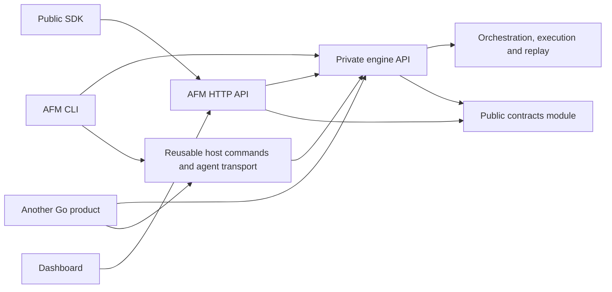

# Engine and AFM 3.x builds

AFM is still one executable. Its CLI calls an embedded Go engine directly;
dashboard and core mode use the same engine. The SDK communicates with AFM over
HTTP. Core mode supports interactive questions, answers, approval, and other
stage controls without loading the dashboard.

## Source access

`github.com/akopichin/afm-engine` is a private Go module. Full AFM builds and direct
embedding require access to its sources. `go get` downloads those sources; a Go
import does not provide binary-only distribution. Users of a ready-built AFM need
neither repository access nor Go. The public SDK can launch or connect to that
binary, including `afm run --mode core`.

The public repository contains the CLI composition, HTTP API, dashboard, SDK,
and the independent `contracts` module. Public CI tests contracts, SDK, and UI
without private credentials. Full builds and runtime integration run in trusted
engine CI. Private dependencies are not vendored into this repository.

## Development across repositories

Check out both repositories and use `scripts/dev-workspace.sh /path/to/afm-engine`
from AFM to create an ignored local workspace. Develop execution changes in
engine and product behavior in AFM. The engine's `examples/minimal` is an
independent consumer module with real deterministic subprocess agents, mesh,
interactive controls, cancellation, and recovery tests.

For an optional real-provider integration check, set `AFM_MESH_SMOKE_COMMAND` to
an authenticated adapter and run `make mesh-smoke ENGINE_DIR=/path/to/afm-engine`
with that workspace. Deterministic tests do not need provider credentials.

Consumers keep exact versions in `go.mod`. Before updating AFM, test the engine,
update its pin explicitly, and repeat AFM tests. Verify the final build with
`GOWORK=off`; local workspaces must not conceal an unavailable revision. Publish
contracts before engine versions that require them, and engine before AFM builds
that require that revision. An engine release does not release AFM automatically.

AFM 3.x pins engine `v1.0.0`. Engine tags and AFM product tags are independent;
upgrading the engine requires an explicit `go.mod`/`go.sum` change and AFM
integration checks. The engine's own CI validates its internal suite before
that version is adopted by a consumer.

## Moving from 2.x

The `v2.x` branch preserves the independent public build and its existing
architecture. Its maintenance channels are `afm@2` / `afm-2` and Docker `:2`.
Their availability depends on publication of a maintenance release; branch
creation alone does not publish artifacts.

Back up `.afm/runs` before trying 3.x on existing runs. Recovery tests use copies
of 2.x journals. Keep the original copies for returning to 2.x; do not assume an
older executable can read journals subsequently changed by 3.x. Flow/config and
the SDK HTTP contract remain compatible where their corresponding tests cover
the behavior.

Only the reviewed public result is transferred to `main`. The full local `v3.x`
development history contains engine sources and must not be pushed to the public
repository. Previously published AFM history is preserved.

## Release preparation

Trusted builds record the AFM and engine/contracts commits, module checksums,
runtime protocol version, toolchain, and archive checksums in a build manifest.
Docker packaging takes prepared binaries
and public runtime scripts; it does not copy private module sources into layers.
Retries reuse the same reviewed artifacts and never move a published tag.

Engine licensing must be resolved before closed-source distribution: extraction
does not change existing license obligations or make previously public code
secret. Local preparation creates no release tags or published artifacts.
