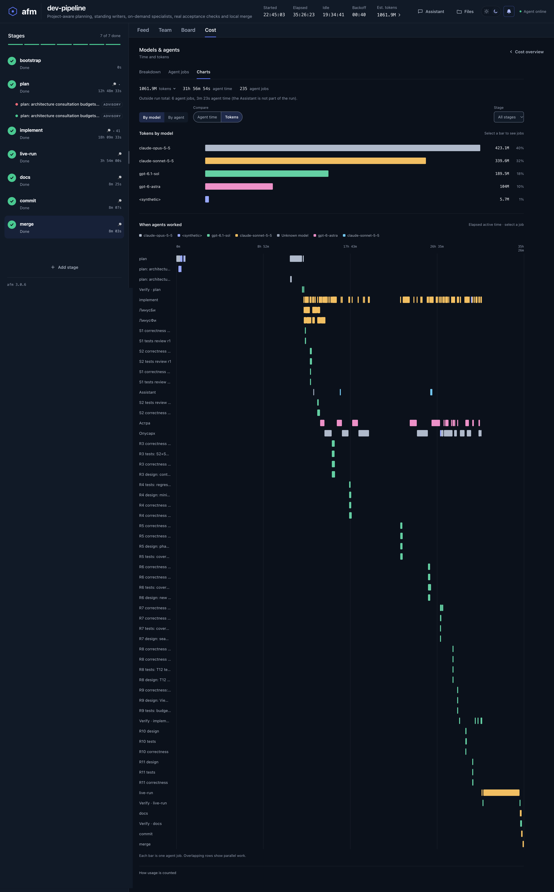
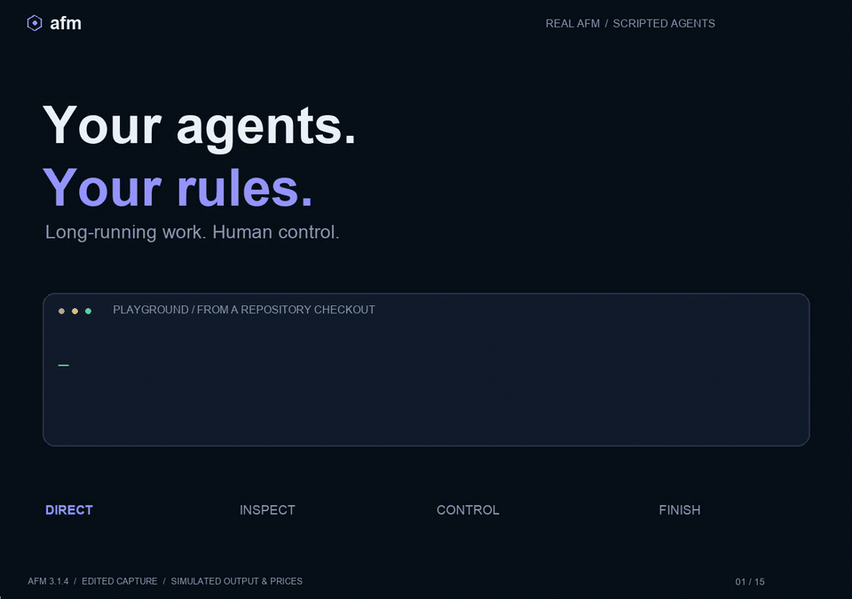

# afm

**Your agents. One team. You're in control.**

Build a pipeline around the way you work, or start with a ready-made one.
Choose the stages, agents, checks and approval points — from a single task to
hours of coordinated work. Steer the run in the dashboard, inspect results,
compare agent time and estimated spend, and manage budgets. Runs keep their
recorded progress across restarts.

- [Try the playground](playground.md): simulated agents, real dashboard,
  parallel work, Cost charts and a budget you can raise. No model account needed.
- [Run a pipeline](pipelines.md): use the
  [afm-pipelines catalog](https://github.com/akopichin/afm-pipelines) for development,
  independent review or an architecture workshop.
- [Create your own flow](getting-started.md): choose stages, dependencies and checks.

<details>
<summary>A real long run: 7 stages, 235 agent jobs, over 35 hours elapsed</summary>



</details>

Explore [Cost and agent charts](dashboard.md#models-and-agents) and
[spending budgets](budgets.md) to understand and control the work.

## Watch the playground



[Try it yourself](playground.md) to explore the full workflow.
The UI is real; agent output and prices are simulated.

## Why afm, when Claude Code already exists

- **Agents that coordinate directly.** QA reports a bug, Architect checks
  the finding, Frontend fixes it, and DevOps picks up QA's passing tests — through
  conversations, a shared board and durable waits. You follow and steer it in
  the stage **Feed** and the **Team** tab; see [Helpers and collaboration](collaboration.md).
- **Tasks measured in hours, not minutes.** Every run is written to an append-only
  event log; if it's interrupted, `afm run` resumes from the same point — completed
  stages are skipped, interrupted ones retried, and agents' conversations and waits
  come back with it.
- **Several models in one flow.** Claude plans, a cheaper model (GLM/DeepSeek) does
  the routine work, another reviews — each stage can use a different agent.
- **A human in the loop at the plan level.** Review and comment on the plan
  line-by-line *before* any code is written, like a merge request.
- **An explicit dependency graph and artifacts** between stages, instead of implicit
  shared context.
- **Everything on disk** — logs, events, and (with `--debug`) the exact prompt each
  agent received. You can see what happened after the fact.

## Quick start

```bash
brew install --cask akopichin/afm/afm
afm init   # scaffold a flow into .afm/flows/ interactively
afm run    # run the flow from .afm/flows (or: afm run path/to/flow.yaml)
```

A live dashboard comes up at `http://localhost:9876` (its URL is printed to the log).

Then head to **[Getting started](getting-started.md)** for the full walkthrough,
or the **[flow.yaml reference](flow-reference.md)** for every field.

## Documentation map

| Topic | Page |
|-------|------|
| Install, first flow, approving plans | [Getting started](getting-started.md) |
| Every `flow.yaml` field | [flow.yaml reference](flow-reference.md) |
| `config.yaml`, `--dir`, `--debug` | [Configuration](config-reference.md) |
| Statuses and resume | [Stage lifecycle](stage-lifecycle.md) |
| `agents: [auto]` | [Autonomous track](autonomous-track.md) |
| Independent AI/shell verification gate | [AI-verify](verify.md) |
| `script:` stages and hooks | [Script stages & hooks](script-stages.md) |
| Dialog with the agent | [Interactive stages](interactive-stages.md) |
| Passing data between stages | [Artifacts & inputs](artifacts.md) |
| Carrying lessons across runs | [Agent memory](agent-memory.md) |
| The web dashboard | [Dashboard](dashboard.md) |
| AFM from a private Telegram chat | [Telegram bot](telegram-bot.md) |
| Helper roles, required tasks, discussion | [Helpers and collaboration](collaboration.md) |
| Driving a real Chrome from a stage | [Managed browser](browser.md) |
| Running in Docker, non-Claude agents | [Docker mode](docker.md) |
| Driving afm from Go | [Go SDK](sdk.md) |
| Event log, directory layout, prompts | [Internals](internals/directory-layout.md) |
